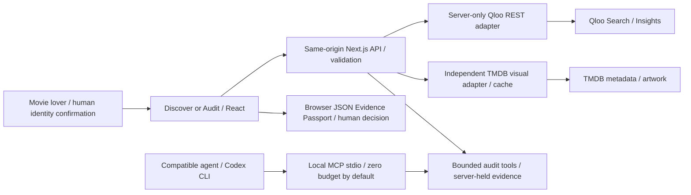

# TasteProbe

[Open TasteProbe](https://tasteprobe-production.up.railway.app) | [GitHub source](https://github.com/jpablortiz96/tasteprobe)

Discover new movies from films you love, or audit another AI's shortlist with verifiable cultural evidence.

**Qloo provides discovery, ranking and observed affinity. TMDB provides optional artwork.** TasteProbe keeps identity confirmation, cultural evidence, visual metadata and human review separate. Affinity is never presented as a probability of satisfaction.

## Two product modes

- **Discover for me:** enter one to three favorite films, search and confirm their identities, discover new movies, inspect explanations and download an Evidence Passport.
- **Audit another AI:** supply favorites and an original shortlist, confirm every identity, compare the actual Qloo order and observed affinities, then use Rescue My Recommendations to propose a verified reordering. Approve/Reject records a local human decision; it never overwrites the source evidence automatically.

Missing, ambiguous or incomplete evidence produces abstention. Movies or scores are not invented. Historical/synthetic demonstrations are labeled and never substituted for a current LIVE response.

## Run locally

Use Node **24.13+** and npm. On Windows PowerShell use npm.cmd/codex.cmd if script execution policy blocks their .ps1 wrappers.

~~~powershell
npm.cmd ci
npm.cmd test
npm.cmd run typecheck
npm.cmd run build
npm.cmd start
~~~

Open http://127.0.0.1:3000. Both dev/start bind to loopback. Do not rebuild or restart during an active acceptance session: in-memory sessions and signed confirmations expire on restart.

Configure ignored .env.local manually, never through chat or browser:

- QLOO_API_KEY: authorized Qloo event credential; official host https://hackathon.api.qloo.com.
- TMDB_READ_ACCESS_TOKEN preferred; TMDB_API_KEY is a server-only fallback.

Do not prefix credentials with NEXT_PUBLIC. Without Qloo access the UI shows BLOCKED_LIVE; missing TMDB credentials or ambiguous artwork retains the illustrative fallback. Restart after configuring credentials, before starting the acceptance flow. A configured server is not proof of LIVE access.

## Connect an AI agent

TasteProbe has an actual local **MCP stdio** adapter and four tools: resolve_entities, evaluate_candidates, compare_cultural_signals, propose_evidence_based_revision. The default MCP Qloo allowance is **zero**. No additional LLM or agent framework is embedded in the app.

~~~powershell
node scripts/verify-mcp-stdio.mjs
node scripts/codex-mcp-demo.mjs
~~~

The first command checks MCP protocol/tool execution, not model behavior. The second connects an actual authenticated Codex CLI session using ephemeral configuration and demonstrates model-selected, structured abstention without Qloo calls. An actual Codex session was verified; raw private reasoning is not recorded. See [Connect an AI agent](docs/CONNECT_AN_AI_AGENT.md) for exact prerequisites, evidence and limitations. The older stdin/HTTP bridge remains available; it is not misrepresented as MCP.

## Verification

~~~powershell
npm.cmd test
npm.cmd run typecheck
npm.cmd run build
npm.cmd run test:integration
npm.cmd audit
node --env-file=.env.local scripts/verify-secrets.mjs gate4a
~~~

Current checks preserve the original suites: **121 tests, seven isolated MOCK HTTP E2E**, typecheck/build and audit pass. Gate 2H.2 built a source-only snapshot without touching the operator's active Next build. Tests do not substitute for real-browser acceptance; [EVIDENCE.md](EVIDENCE.md) and [GATE 2H.2 review](evidence/GATE2H2_REVIEW.md) distinguish operator observations, downloaded LIVE exports, protocol tests and actual Codex client events.

[TMDB integration](docs/TMDB_INTEGRATION.md) documents identity matching, actual provider checks and required attribution. Arrival (2016) currently retains fallback because TMDB has two same-title/year/original-title movies and no trusted Qloo external-ID binding is available. No poster is chosen by popularity or a guessed URL.

For no-API UI review, set TASTEPROBE_VISUAL_REVIEW=synthetic and run dev on a separate loopback port, then open /review. It remains disabled in production. Cultural values stay SYNTHETIC / NOT LIVE; an optional dated artwork sample may load from TMDB CDN. The operator's real-browser and download checks remain the acceptance criterion.

## Security and evidence boundaries

- Qloo transport is server-only, fixed host/endpoints, eight-second timeout, bounded response, no redirects or automatic retries. Signed movie identities require human confirmation. Browser requests use relative same-origin paths with strict origin/port validation.
- Local Qloo cap: 12 attempts/minute and 60/process, including failures. Tool sessions: 12 conservative reservations, 16 steps, 20 minutes; at most 20 concurrent sessions. Configured server signing secrets preserve identity proofs across instances/restarts until their 30-minute expiry; loopback without a secret retains ephemeral signing. Audit sessions still require a single process. MCP additionally enforces its own explicit allowance before dispatch.
- TMDB is independently bounded/cache-backed and cannot change Qloo ranking or affinity. Credentials and raw provider headers are not returned to the browser or Passport.
- Reports preserve source, request reference, retrieval date, candidate coverage, observed scores, limitations and actual tool events. They exclude authorization proofs and private model reasoning.
- Operator LIVE budgets are explicit and independent of technical caps. Do not replay historical smoke scripts or A/B experiments without fresh authorization.

Original source is licensed under [MIT](LICENSE). Provider artwork, data and branding are governed separately; see [third-party notices](THIRD_PARTY_NOTICES.md). TasteProbe is published on GitHub and Railway. HTTPS, exact-origin CSRF, one running replica, production Redis admission, static assets and cross-request tool state are verified. Fresh public Discover/Audit LIVE user acceptance remains pending a separate authorized budget. See [deployment preparation](docs/DEPLOYMENT.md), [Devpost draft](docs/DEVPOST_FINAL.md) and [EVIDENCE.md](EVIDENCE.md).

## Architecture



Only Qloo supplies cultural ranking and observed affinity. TMDB imagery cannot affect ordering. The agent chooses bounded tools; missing evidence produces structured abstention. Human approval never automatically replaces the source ranking. Audit sessions and optional visual caches are process-local; identity signing can be stable and public provider budgets use shared Redis. The full workflow still requires one long-running process.

## Controlled cultural stress test

The historical October 30, 2026 A/B capture changed Arrival (2016) to Paddington 2 (2017) while retaining Interstellar, Blade Runner 2049 and Her as candidates. Both scenarios returned 3/3; actual order and observed query.affinity differed. This is dated evidence of a signal-dependent response, not a claim of causal preference or a superior list. No historical data is hardcoded as a current LIVE recommendation.

```powershell
node scripts/verify-gate2a1.mjs
```

This verifier is offline. [Captured parameters, request ledger and results](evidence/gate2a1-ab.json) permit independent inspection without using another API request.

## Release candidate acceptance

The operator verified Chrome Discover, the correct Audit 3/3 result, Rescue, approval and Passport download, including desktop 1440x900 and mobile 390x844. Same-analysis Reject serialization is verified offline with an explicitly SYNTHETIC fixture and network disabled; the original LIVE Reject export is unavailable. This distinction is retained in the evidence ledger.

No authentic screenshot files have been supplied to the repository. [Screenshot checklist](docs/screenshots/README.md) identifies the captures still needed; no synthetic screenshot is presented as LIVE evidence. No demo or repository URL is invented.

For source and history checks without provider requests:

```powershell
node --env-file=.env.local scripts/verify-secrets.mjs gate4a
node --env-file=.env.local scripts/verify-release-history.mjs gate4a
```

Do not run smoke:qloo or LIVE runners without a new explicit budget. Copy .env.example to ignored .env.local and populate values manually; never put credentials in client variables, source, logs or screenshots. Existing validation scripts may write dated evidence artifacts; review their diff before committing.

## Credits

This product uses the TMDB API but is not endorsed or certified by TMDB. The application Credits section displays the approved TMDB logo. Non-commercial attribution conditions and separate artwork rights apply; [TMDB FAQ](https://developer.themoviedb.org/docs/faq). Qloo is the cultural evidence provider. TasteProbe is not a guarantee of personal satisfaction.

## Public hardening - GATE 4A

Use `npm run start:public` only for an explicitly approved external deployment. It binds 0.0.0.0/$PORT and refuses incomplete HTTPS/signing/shared-quota configuration. Primary target: one Railway replica; Vercel is not supported unchanged because Audit/Rescue state remains in memory.

Public provider attempts require an atomic Redis reservation before fetch; storage failure denies consumption. Total allowances must be explicitly approved, not guessed from historical tests. Redis and signing credentials are server-only. Missing configuration cannot fall back to unlimited public usage. Redis/Lua was also verified against real Upstash in isolated preflight namespaces: two processes, exact global cap, independent providers, client/operation caps and shared halt. The public Railway deployment now also verifies own/foreign Origin handling, real Redis admission and retained session state. Official provider balance and fresh public LIVE user acceptance are not inferred from those checks. No PRODUCTION_READY claim is made. See [exact variables and operator commands](docs/DEPLOYMENT.md).

Redis diagnostics: `node scripts/check-public-quota.mjs --preflight` and `node scripts/verify-shared-quota.mjs` automatically load quota variables from ignored .env.local and reject conflicting process variables without printing values. Run from an external PowerShell when the restricted sandbox reports EACCES. See [real Redis evidence](evidence/gate4b2-real-redis.json). Railway Config as Code is deprecated for new services: use the reviewed current IaC workflow in [deployment instructions](docs/DEPLOYMENT.md); the old JSON is archived under docs and does not configure a new service.

## Published release

The demo runs on one Railway replica with PORT=8080, start:public, healthcheck /api/health and no persistent filesystem requirement. Source upload/deployment used CLI after reviewing the IaC plan. Existing runtime secrets are preserved in .railway/railway.ts without storing values there. The pinned Railway SDK is a development-only infrastructure dependency. The current workspace plan is unchanged; ordinary resource consumption is metered, not claimed to be free.

[Public verification](evidence/final-public-verification.json) covers home/assets, HTTPS, production /review 404, foreign-origin rejection and a real session/tool abstention with zero Qloo/TMDB calls. It is not a fresh LIVE recommendation acceptance test or an autonomous LLM audit. Previous genuine Qloo Discover/Audit evidence is historical and remains dated.

Public demo internal caps are 40 Qloo / 200 TMDB; planned Qloo reserve for judges is 30. These are not provider-account balances. Anonymous callers share a conservative bucket because no user-controlled IP header is trusted. For an explicitly authorized seven-request operator acceptance, complete Discover (up to two Qloo calls), wait at least 61 seconds, then Audit the four exact identities (up to five). Stop on the first auth/quota/network/contract failure, do not retry and do not run Challenge. Rescue review/approval/rejection and export do not need additional Qloo calls.
