# TasteProbe

### Your agent recommends. TasteProbe verifies.

**Find your next film. Challenge a convincing shortlist. Keep the cultural evidence.**

[**Live Demo**](https://tasteprobe-production.up.railway.app) &nbsp; [**GitHub**](https://github.com/jpablortiz96/tasteprobe) &nbsp; [**Agent connection**](docs/CONNECT_AN_AI_AGENT.md) &nbsp; [**Devpost material**](docs/DEVPOST_FINAL.md)

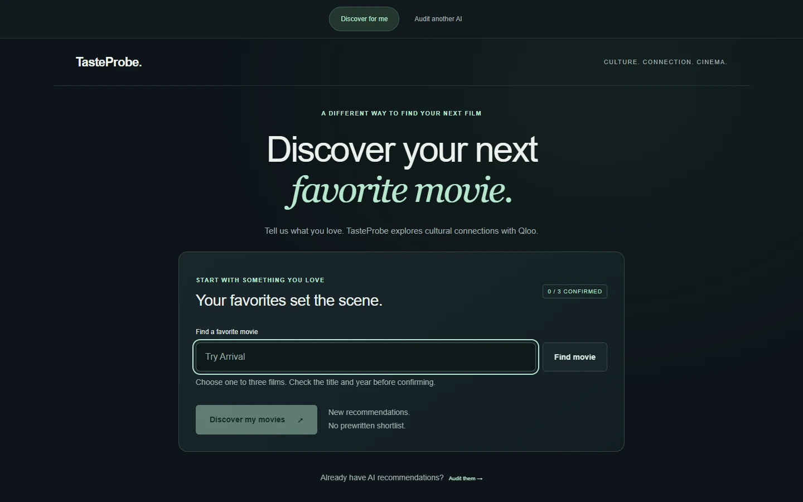

[Discover](#discover-for-me) · [Audit](#audit-another-ai) · [Rescue](#rescue-my-recommendations) · [Passport](#evidence-passport) · [Architecture](#system-architecture) · [Agentic MCP](#agentic-workflow) · [Gallery](#gallery) · [Setup](#run-locally)

A movie list can sound persuasive without revealing how it relates to the culture you love. TasteProbe lets you discover films from confirmed favorites, or inspect another AI's recommendations against authentic Qloo evidence. You see the source, the observed affinities and the limits before deciding what to keep.

**Qloo is the cultural engine. TMDB is the visual layer. Human review stays in control.**

## Discover for Me

One to three favorite movies are enough. Search, explicitly confirm the right title and year, then ask Qloo for new movies. Favorites are excluded; duplicate or invalid results are filtered.

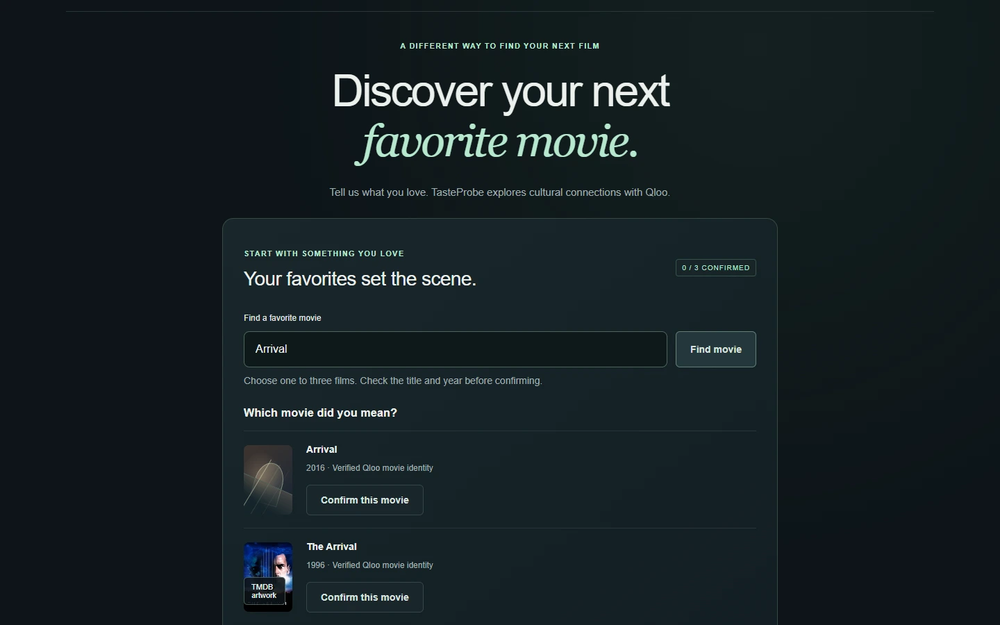

The results dashboard shows what was actually returned, how many favorites were confirmed and the highest observed affinity. In this production capture, Arrival led to eight new movies.

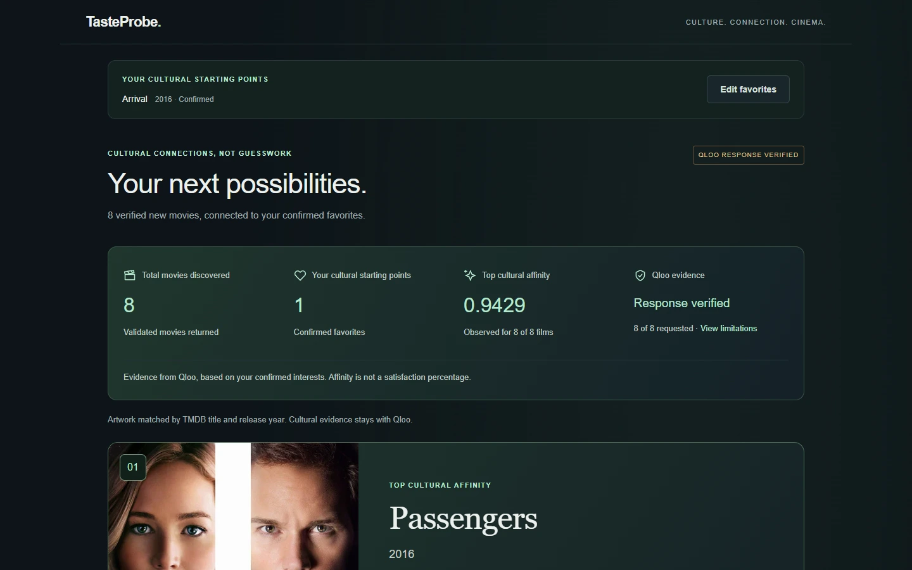

The featured recommendation is selected from the response, with Qloo order breaking affinity ties. Artwork never changes the ranking. Individual attribution was unavailable in this response, so the interface says so.

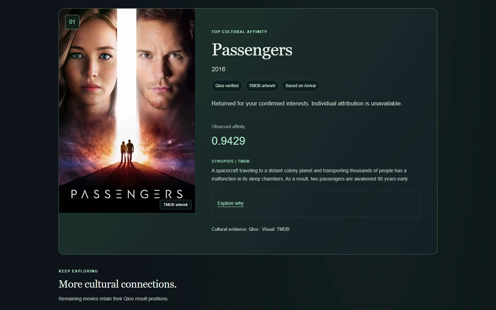

## Audit Another AI

Bring your original recommendations in their original order. Confirm each Qloo identity and evaluate the same candidates. The comparison preserves the original list alongside Qloo's actual order and observed affinities.

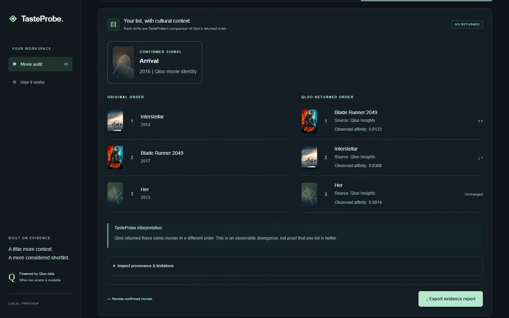

In this dated capture, Arrival (2016) was the signal. Qloo returned Blade Runner 2049, Interstellar and Her (2013), with coverage 3/3. That is an observable divergence, not proof that one list is better. Future results may differ.

## Rescue My Recommendations

A bounded tool proposes a reordering of the same verified candidates only when evidence is complete. Approve or Keep original list records your decision without replacing the source evidence. Partial coverage produces abstention.

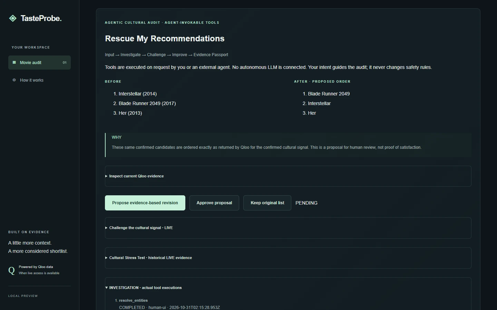

Both APPROVED and REJECTED Passports were downloaded from this same public analysis and checked: identities, affinities, evaluation and proposal remained unchanged. No additional Qloo request was required.

## Evidence Passport

Take the context with you: confirmed identities, cultural signals, results, observed affinity, source, retrieval date, limitations and actual tool executions. No credentials, authorization proofs or private model reasoning belong in the export.

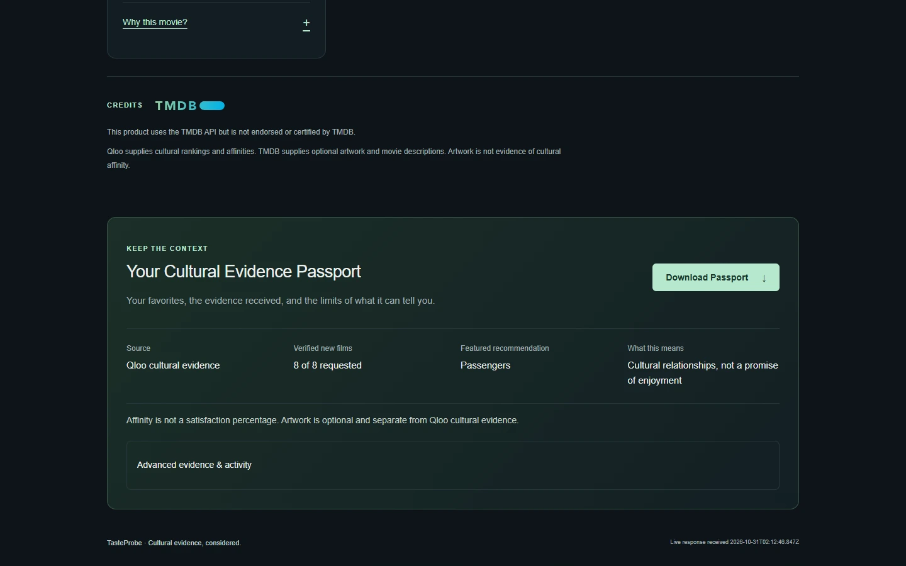

## Qloo cultural intelligence

- **Search** resolves cultural identities; a person confirms the exact movie.
- **Insights Discover** uses confirmed favorites and excludes those favorites without restricting exploration to a shortlist.
- **Insights Audit** evaluates only the confirmed original candidates.
- **Affinity** is an observed cultural relationship, never a satisfaction percentage. Missing values and explainability remain missing.
- **Abstention** protects incomplete or unverifiable evidence. TMDB metadata cannot supply missing Qloo scores.

## System architecture

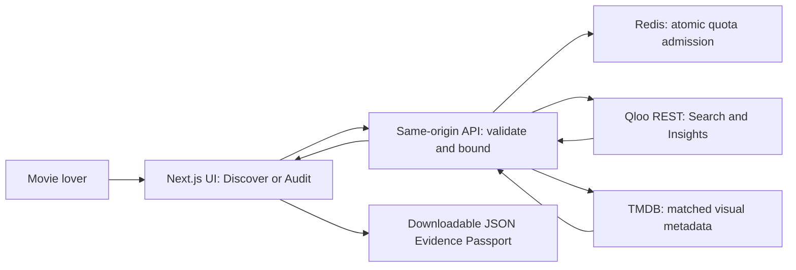

Railway runs one persistent Node process because Audit/Rescue sessions are process-local. Signing uses a stable server secret; provider admission uses shared atomic Redis limits and fails closed. Qloo and TMDB use fixed server-side destinations.

## Agentic workflow

TasteProbe is an **agent-invocable tool integration**, with a local MCP stdio adapter. A compatible agent can select bounded tools; the website does not embed an autonomous LLM.

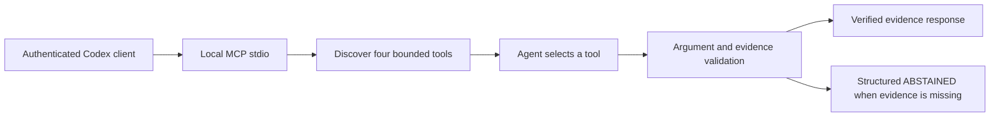

**Actually demonstrated:** authenticated Codex discovered the tools, selected `propose_evidence_based_revision` with empty arguments, received **ABSTAINED** because no verified evaluation existed, and interpreted that limitation. It consumed zero Qloo requests. This demonstrates real agent/tool invocation, not an autonomous complete LIVE audit.

[Actual Codex MCP evidence](evidence/gate2h2-codex-mcp.json) · [Reproduce the connection](docs/CONNECT_AN_AI_AGENT.md) · [Tool contracts](docs/AGENT_TOOLS.md)

## Gallery

**15 authentic Chrome captures:** 13 desktop at 1440 x 900 and two mobile at 390 x 844. Captured October 30, 2026, Colombia time. Input screens are STATIC; identity and recommendation screens are LIVE, as documented individually. Screenshots are dated evidence, not data hardcoded into the product.

[Full gallery and provenance manifest](docs/screenshots/MANIFEST.md) · [Capture and public acceptance ledger](evidence/gate5-visual-delivery.json)

<details>
<summary>More of the journey: input, confirmation, cards, explanations and mobile</summary>

### Arrival entered before any provider search.


### Arrival (2016) explicitly confirmed; discovery is enabled.

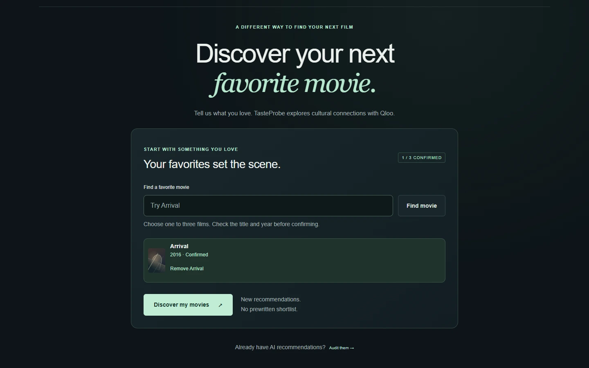

### Additional authentic Qloo results retain their returned positions.

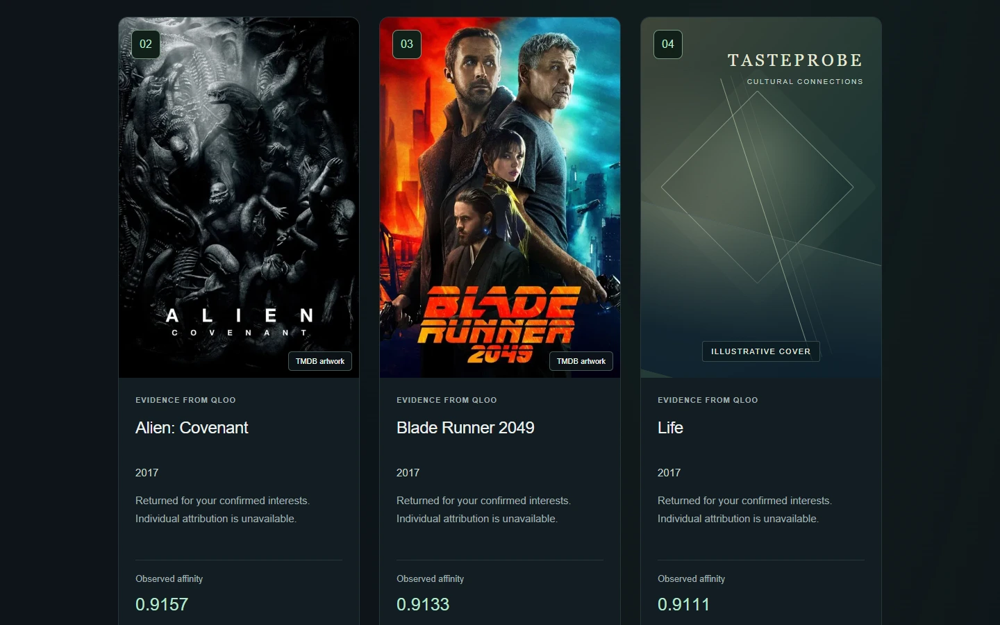

### Expanded evidence states that individual attribution is unavailable; no explanation is invented.

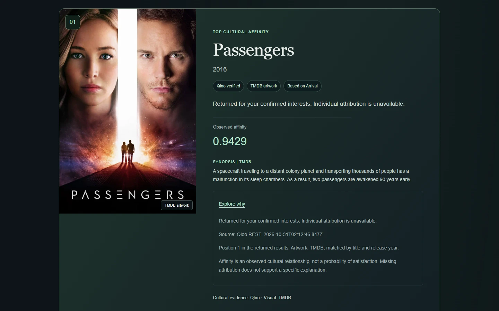

### The original Audit input: Arrival and three ordered candidates.

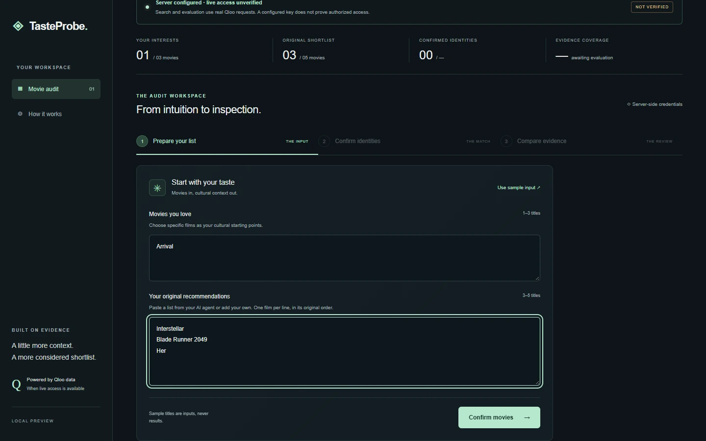

### Four Qloo identities confirmed, including Her (2013), with safe artwork fallbacks.

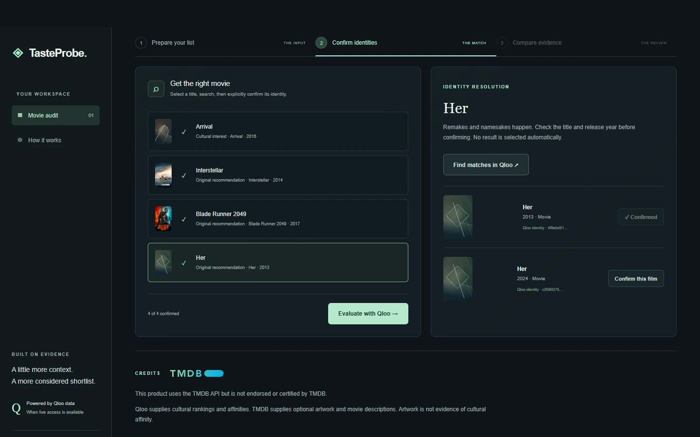

### The same loaded Discover evidence at a mobile viewport.

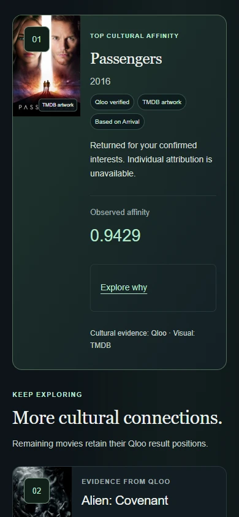

### The same loaded Audit comparison at a mobile viewport; the page continues below the capture.

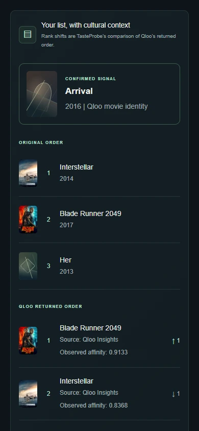

</details>

## Verified results and limits

Production Chrome acceptance completed Discover, Audit 3/3, Rescue, Approve, Reject and three Passport downloads. Both mobile views had no horizontal overflow. Seven authorized Qloo attempts succeeded, without retries or Challenge; the observed shared counter retained 33/40 for subsequent use, including the planned 30-request judge reserve. This is an internal cap, not a provider balance.

Arrival and Her retained illustrative artwork when matching was ambiguous. Missing attribution was disclosed. Historical A/B evidence is dated separately. The real MCP demonstration abstained; a full autonomous LIVE agent audit has not been demonstrated.

## Technologies

Next.js App Router · React · TypeScript · Node.js native fetch and test runner · Qloo REST · TMDB API · Upstash Redis REST/Lua · MCP stdio · Codex CLI · Railway · CSS · JSON Evidence Passports

## Run locally

Use Node **24.13+** and npm. On Windows PowerShell use npm.cmd/codex.cmd if script execution policy blocks their .ps1 wrappers.

~~~powershell
npm.cmd ci
npm.cmd test
npm.cmd run typecheck
npm.cmd run build
npm.cmd start
~~~

Open http://127.0.0.1:3000. Both dev/start bind to loopback. Do not rebuild or restart during an active acceptance session: in-memory sessions and signed confirmations expire on restart.

Configure ignored .env.local manually, never through chat or browser:

- QLOO_API_KEY: authorized Qloo event credential; official host https://hackathon.api.qloo.com.
- TMDB_READ_ACCESS_TOKEN preferred; TMDB_API_KEY is a server-only fallback.

Do not prefix credentials with NEXT_PUBLIC. Without Qloo access the UI shows BLOCKED_LIVE; missing TMDB credentials or ambiguous artwork retains the illustrative fallback. Restart after configuring credentials, before starting the acceptance flow. A configured server is not proof of LIVE access.

## Connect an AI agent

TasteProbe has an actual local **MCP stdio** adapter and four tools: resolve_entities, evaluate_candidates, compare_cultural_signals, propose_evidence_based_revision. The default MCP Qloo allowance is **zero**. No additional LLM or agent framework is embedded in the app.

~~~powershell
node scripts/verify-mcp-stdio.mjs
node scripts/codex-mcp-demo.mjs
~~~

The first command checks MCP protocol/tool execution, not model behavior. The second connects an actual authenticated Codex CLI session using ephemeral configuration and demonstrates model-selected, structured abstention without Qloo calls. An actual Codex session was verified; raw private reasoning is not recorded. See [Connect an AI agent](docs/CONNECT_AN_AI_AGENT.md) for exact prerequisites, evidence and limitations. The older stdin/HTTP bridge remains available; it is not misrepresented as MCP.

## Verification

~~~powershell
npm.cmd test
npm.cmd run typecheck
npm.cmd run build
npm.cmd run test:integration
npm.cmd audit
node --env-file=.env.local scripts/verify-secrets.mjs gate4a
~~~

Current checks preserve the original suites: **121 tests, seven isolated MOCK HTTP E2E**, typecheck/build and audit pass. Gate 2H.2 built a source-only snapshot without touching the operator's active Next build. Tests do not substitute for real-browser acceptance; [EVIDENCE.md](EVIDENCE.md) and [GATE 2H.2 review](evidence/GATE2H2_REVIEW.md) distinguish operator observations, downloaded LIVE exports, protocol tests and actual Codex client events.

[TMDB integration](docs/TMDB_INTEGRATION.md) documents identity matching, actual provider checks and required attribution. Arrival (2016) currently retains fallback because TMDB has two same-title/year/original-title movies and no trusted Qloo external-ID binding is available. No poster is chosen by popularity or a guessed URL.

For no-API UI review, set TASTEPROBE_VISUAL_REVIEW=synthetic and run dev on a separate loopback port, then open /review. It remains disabled in production. Cultural values stay SYNTHETIC / NOT LIVE; an optional dated artwork sample may load from TMDB CDN. The operator's real-browser and download checks remain the acceptance criterion.

## Security and evidence boundaries

- Qloo transport is server-only, fixed host/endpoints, eight-second timeout, bounded response, no redirects or automatic retries. Signed movie identities require human confirmation. Browser requests use relative same-origin paths with strict origin/port validation.
- Local Qloo cap: 12 attempts/minute and 60/process, including failures. Tool sessions: 12 conservative reservations, 16 steps, 20 minutes; at most 20 concurrent sessions. Configured server signing secrets preserve identity proofs across instances/restarts until their 30-minute expiry; loopback without a secret retains ephemeral signing. Audit sessions still require a single process. MCP additionally enforces its own explicit allowance before dispatch.
- TMDB is independently bounded/cache-backed and cannot change Qloo ranking or affinity. Credentials and raw provider headers are not returned to the browser or Passport.
- Reports preserve source, request reference, retrieval date, candidate coverage, observed scores, limitations and actual tool events. They exclude authorization proofs and private model reasoning.
- Operator LIVE budgets are explicit and independent of technical caps. Do not replay historical smoke scripts or A/B experiments without fresh authorization.

Original source is licensed under [MIT](LICENSE). Provider artwork, data and branding are governed separately; see [third-party notices](THIRD_PARTY_NOTICES.md). TasteProbe is published on GitHub and Railway. HTTPS, exact-origin CSRF, one running replica, production Redis admission, static assets and cross-request tool state are verified. Fresh production Chrome Discover/Audit acceptance is now recorded in the GATE 5 capture ledger. See [deployment preparation](docs/DEPLOYMENT.md), [Devpost draft](docs/DEVPOST_FINAL.md) and [EVIDENCE.md](EVIDENCE.md).

## Controlled cultural stress test

The historical October 30, 2026 A/B capture changed Arrival (2016) to Paddington 2 (2017) while retaining Interstellar, Blade Runner 2049 and Her as candidates. Both scenarios returned 3/3; actual order and observed query.affinity differed. This is dated evidence of a signal-dependent response, not a claim of causal preference or a superior list. No historical data is hardcoded as a current LIVE recommendation.

```powershell
node scripts/verify-gate2a1.mjs
```

This verifier is offline. [Captured parameters, request ledger and results](evidence/gate2a1-ab.json) permit independent inspection without using another API request.

## Release candidate acceptance

The operator verified Chrome Discover, the correct Audit 3/3 result, Rescue, approval and Passport download, including desktop 1440x900 and mobile 390x844. Same-analysis Reject serialization was verified offline and subsequently verified with fresh production APPROVED and REJECTED downloads during GATE 5. This distinction is retained in the evidence ledger.

Fifteen authentic production Chrome screenshots are now published with individual LIVE/STATIC labels in the [manifest](docs/screenshots/MANIFEST.md).

For source and history checks without provider requests:

```powershell
node --env-file=.env.local scripts/verify-secrets.mjs gate4a
node --env-file=.env.local scripts/verify-release-history.mjs gate4a
```

Do not run smoke:qloo or LIVE runners without a new explicit budget. Copy .env.example to ignored .env.local and populate values manually; never put credentials in client variables, source, logs or screenshots. Existing validation scripts may write dated evidence artifacts; review their diff before committing.

## Credits

This product uses the TMDB API but is not endorsed or certified by TMDB. The application Credits section displays the approved TMDB logo. Non-commercial attribution conditions and separate artwork rights apply; [TMDB FAQ](https://developer.themoviedb.org/docs/faq). Qloo is the cultural evidence provider. TasteProbe is not a guarantee of personal satisfaction.

## Public hardening - GATE 4A

Use `npm run start:public` only for an explicitly approved external deployment. It binds 0.0.0.0/$PORT and refuses incomplete HTTPS/signing/shared-quota configuration. Primary target: one Railway replica; Vercel is not supported unchanged because Audit/Rescue state remains in memory.

Public provider attempts require an atomic Redis reservation before fetch; storage failure denies consumption. Total allowances must be explicitly approved, not guessed from historical tests. Redis and signing credentials are server-only. Missing configuration cannot fall back to unlimited public usage. Redis/Lua was also verified against real Upstash in isolated preflight namespaces: two processes, exact global cap, independent providers, client/operation caps and shared halt. The public Railway deployment now also verifies own/foreign Origin handling, real Redis admission and retained session state. Official provider balance is not inferred from those checks. Fresh public browser acceptance is recorded separately in GATE 5. No PRODUCTION_READY claim is made. See [exact variables and operator commands](docs/DEPLOYMENT.md).

Redis diagnostics: `node scripts/check-public-quota.mjs --preflight` and `node scripts/verify-shared-quota.mjs` automatically load quota variables from ignored .env.local and reject conflicting process variables without printing values. Run from an external PowerShell when the restricted sandbox reports EACCES. See [real Redis evidence](evidence/gate4b2-real-redis.json). Railway Config as Code is deprecated for new services: use the reviewed current IaC workflow in [deployment instructions](docs/DEPLOYMENT.md); the old JSON is archived under docs and does not configure a new service.

## Published release

The demo runs on one Railway replica with PORT=8080, start:public, healthcheck /api/health and no persistent filesystem requirement. Source upload/deployment used CLI after reviewing the IaC plan. Existing runtime secrets are preserved in .railway/railway.ts without storing values there. The pinned Railway SDK is a development-only infrastructure dependency. The current workspace plan is unchanged; ordinary resource consumption is metered, not claimed to be free.

[Public verification](evidence/final-public-verification.json) covers home/assets, HTTPS, production /review 404, foreign-origin rejection and a real session/tool abstention with zero Qloo/TMDB calls. That earlier artifact is not a LIVE recommendation test or an autonomous LLM audit; fresh production recommendation acceptance is recorded in GATE 5. Previous genuine Qloo Discover/Audit evidence is historical and remains dated.

Public demo internal caps are 40 Qloo / 200 TMDB; planned Qloo reserve for judges is 30. These are not provider-account balances. Anonymous callers share a conservative bucket because no user-controlled IP header is trusted. For an explicitly authorized seven-request operator acceptance, complete Discover (up to two Qloo calls), wait at least 61 seconds, then Audit the four exact identities (up to five). Stop on the first auth/quota/network/contract failure, do not retry and do not run Challenge. Rescue review/approval/rejection and export do not need additional Qloo calls.
